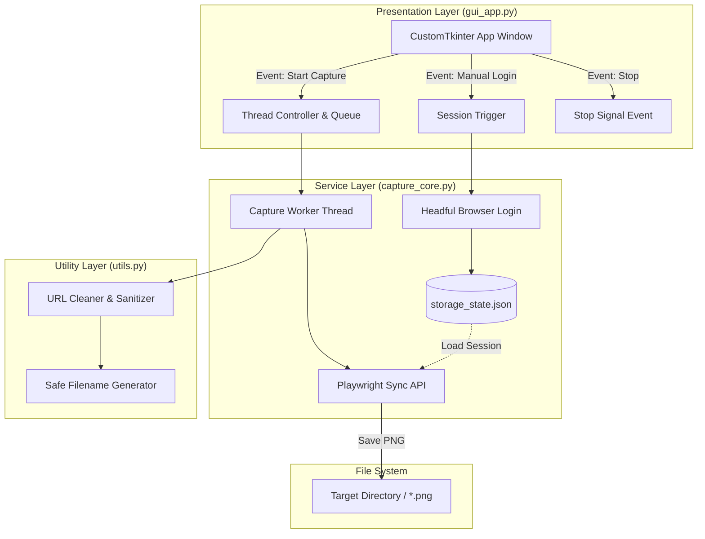

# 웹사이트 화면 캡처 GUI 프로그램 구현 계획서 (Implementation Plan)

> **For agentic workers:** REQUIRED SUB-SKILL: Use superpowers:subagent-driven-development to implement this plan task-by-task. Steps use checkbox (`- [ ]`) syntax for tracking.

**Goal:** 웹사이트 URL 목록 파일을 읽어 각 사이트 화면을 `.png`로 캡처하여 지정 폴더에 저장하고, 브라우저 세션 저장 및 실시간 진행률 표시를 제공하는 데스크톱 GUI 애플리케이션 구축

**Architecture:** CustomTkinter 기반의 GUI 계층과 Playwright 기반의 브라우저 캡처 엔진 계층을 멀티스레딩과 이벤트 큐로 완전 분리하여, 캡처 중에도 UI 멈춤 없이 실시간 진행률/로그 확인 및 취소가 가능하도록 구성

**Architecture Diagram:**



**Tech Stack:** Python 3.10+, `customtkinter`, `playwright`, `pytest`

**Spec:** [docs/superpowers/specs/2026-10-28-web-capture-gui-design.md](file:///c:/CODE/execise/capture_site/docs/superpowers/specs/2026-10-28-web-capture-gui-design.md)

## Global Constraints

- 모든 코드는 PEP 8 표준을 준수하며 모듈 간 순환 참조가 없어야 합니다.
- 파일 경로는 Windows 환경에 호환되도록 `pathlib.Path`를 사용하여 처리합니다.
- UI 메인 스레드에서 무거운 작업(웹 탐색, 파일 I/O 대기 등)을 직접 실행하지 않고 별도 스레드에서 수행해야 합니다.
- 외부 라이브러리는 최소화하여 `customtkinter`와 `playwright`, `pytest`로 한정합니다.

---

### Task 1: 프로젝트 의존성 설정 및 테스트 환경 구축

**Files:**
- Create: `c:/CODE/execise/capture_site/requirements.txt`
- Create: `c:/CODE/execise/capture_site/conftest.py`

**Interfaces:**
- Consumes: 없음
- Produces: `requirements.txt` 의존성 명세

- [x] **Step 1: `requirements.txt` 파일 생성**

```text
customtkinter>=5.2.0
playwright>=1.40.0
pytest>=7.4.0
```

- [x] **Step 2: 기본 테스트 환경용 `conftest.py` 생성**

```python
import sys
from pathlib import Path

# 프로젝트 루트 경로를 sys.path에 추가하여 모듈 임포트 보장
root_dir = Path(__file__).parent.resolve()
if str(root_dir) not in sys.path:
    sys.path.insert(0, str(root_dir))
```

- [x] **Step 3: 의존성 패키지 설치 확인**

Run:
```powershell
pip install -r requirements.txt
playwright install chromium
```
Expected: 패키지 정상 설치 완료

---

### Task 2: URL 정제 및 파일명 안전 변환 유틸리티 (`utils.py`)

**Files:**
- Create: `c:/CODE/execise/capture_site/utils.py`
- Test: `c:/CODE/execise/capture_site/tests/test_utils.py`

**Interfaces:**
- Consumes: URL 문자열 리스트
- Produces:
  - `clean_url_list(raw_lines: list[str]) -> list[str]`
  - `sanitize_filename_from_url(url: str, existing_names: set[str] | None = None) -> str`

- [x] **Step 1: 실패하는 단위 테스트 작성 (`tests/test_utils.py`)**

```python
import pytest
from utils import clean_url_list, sanitize_filename_from_url

def test_clean_url_list():
    raw_lines = [
        "web site",
        "",
        "   ",
        "# 주석 라인",
        "https://doto.kr/dashboard",
        "http://example.com/test   ",
        "invalid-url-string"
    ]
    cleaned = clean_url_list(raw_lines)
    assert cleaned == [
        "https://doto.kr/dashboard",
        "http://example.com/test"
    ]

def test_sanitize_filename_from_url():
    # 기본 경로 변환
    assert sanitize_filename_from_url("https://doto.kr/dashboard") == "dashboard.png"
    # 하위 경로 및 특수문자 변환
    assert sanitize_filename_from_url("https://doto.kr/crm/contacts") == "crm_contacts.png"
    # 메인/루트 도메인 처리
    assert sanitize_filename_from_url("https://doto.kr/") == "main.png"
    assert sanitize_filename_from_url("https://doto.kr") == "main.png"
    # 윈도우 금지 특수문자 치환 (: ? * 등)
    assert sanitize_filename_from_url("https://doto.kr/search?q=test*value") == "search_q_test_value.png"

def test_sanitize_filename_duplicate_handling():
    existing = {"dashboard.png"}
    # 중복 시 _1 접미사 추가 확인
    assert sanitize_filename_from_url("https://doto.kr/dashboard", existing_names=existing) == "dashboard_1.png"
```

- [x] **Step 2: 테스트 실행 및 실패 확인**

Run: `pytest tests/test_utils.py -v`
Expected: FAIL (`ModuleNotFoundError: No module named 'utils'`)

- [x] **Step 3: `utils.py` 최소 구현**

```python
import re
from urllib.parse import urlparse

def clean_url_list(raw_lines: list[str]) -> list[str]:
    """텍스트 파일 라인 목록에서 유효한 HTTP/HTTPS URL만 필터링 및 정제"""
    valid_urls = []
    for line in raw_lines:
        stripped = line.strip()
        if not stripped:
            continue
        if stripped.startswith("#") or stripped.lower() in ("web site", "website", "url", "urls"):
            continue
        if stripped.startswith("http://") or stripped.startswith("https://"):
            valid_urls.append(stripped)
    return valid_urls

def sanitize_filename_from_url(url: str, existing_names: set[str] | None = None) -> str:
    """URL을 Windows에서 사용 가능한 안전한 .png 파일명으로 변환"""
    parsed = urlparse(url)
    path = parsed.path.strip("/")
    query = parsed.query.strip()

    parts = []
    if path:
        parts.append(path)
    if query:
        parts.append(query)

    base = "_".join(parts)
    if not base:
        base = "main"

    # 파일시스템 예약 및 특수문자 치환: \ / : * ? " < > |
    safe_base = re.sub(r'[\\/*?:"<>|]', '_', base)
    # 연속된 언더스코어 정리
    safe_base = re.sub(r'_+', '_', safe_base).strip('_.')

    if not safe_base:
        safe_base = "site"

    filename = f"{safe_base}.png"
    
    if existing_names is not None:
        counter = 1
        original_base = safe_base
        while filename in existing_names:
            filename = f"{original_base}_{counter}.png"
            counter += 1
        existing_names.add(filename)

    return filename
```

- [x] **Step 4: 테스트 재실행 및 통과 확인**

Run: `pytest tests/test_utils.py -v`
Expected: 3 passed in 0.05s

---

### Task 3: Playwright 캡처 코어 및 세션 관리자 구현 (`capture_core.py`)

**Files:**
- Create: `c:/CODE/execise/capture_site/capture_core.py`
- Test: `c:/CODE/execise/capture_site/tests/test_capture_core.py`

**Interfaces:**
- Consumes: `utils.sanitize_filename_from_url`, `pathlib.Path`
- Produces:
  - `CaptureOptions` (dataclass: `full_page`, `delay_seconds`, `viewport_width`, `viewport_height`)
  - `save_browser_session(start_url: str, session_file: Path) -> bool`
  - `capture_urls(urls, output_dir, options, session_file, on_progress, on_log, is_stopped) -> dict`

- [x] **Step 1: 실패하는 단위/모의 테스트 작성 (`tests/test_capture_core.py`)**

```python
import pytest
from pathlib import Path
from capture_core import CaptureOptions

def test_capture_options_defaults():
    opts = CaptureOptions()
    assert opts.full_page is True
    assert opts.delay_seconds == 1.0
    assert opts.viewport_width == 1920
    assert opts.viewport_height == 1080
```

- [x] **Step 2: 테스트 실행 및 실패 확인**

Run: `pytest tests/test_capture_core.py -v`
Expected: FAIL (`ModuleNotFoundError: No module named 'capture_core'`)

- [x] **Step 3: `capture_core.py` 구현**

```python
import time
from dataclasses import dataclass
from pathlib import Path
from typing import Callable, Optional, Set
from playwright.sync_api import sync_playwright
from utils import sanitize_filename_from_url

@dataclass
class CaptureOptions:
    full_page: bool = True
    delay_seconds: float = 1.0
    viewport_width: int = 1920
    viewport_height: int = 1080
    timeout_ms: int = 30000

def save_browser_session(start_url: str, session_file: Path) -> bool:
    """헤드풀 브라우저를 열어 사용자가 로그인하도록 유도한 후 storage_state.json 저장"""
    session_file.parent.mkdir(parents=True, exist_ok=True)
    with sync_playwright() as p:
        browser = p.chromium.launch(headless=False)
        context = browser.new_context()
        page = context.new_page()
        page.goto(start_url)
        
        # 사용자가 브라우저 창을 닫을 때까지 대기
        try:
            page.wait_for_event("close", timeout=0)
        except Exception:
            pass
        
        context.storage_state(path=str(session_file))
        context.close()
        browser.close()
    return session_file.exists()

def capture_urls(
    urls: list[str],
    output_dir: Path,
    options: CaptureOptions,
    session_file: Optional[Path] = None,
    on_progress: Optional[Callable[[int, int, str], None]] = None,
    on_log: Optional[Callable[[str], None]] = None,
    is_stopped: Optional[Callable[[], bool]] = None
) -> dict:
    """지정된 URL 목록을 순회하며 스크린샷 캡처 수행"""
    output_dir.mkdir(parents=True, exist_ok=True)
    results = {"total": len(urls), "success": 0, "failed": 0, "skipped": 0}
    existing_files: Set[str] = set()

    def log(msg: str):
        if on_log:
            on_log(msg)

    with sync_playwright() as p:
        browser = p.chromium.launch(headless=True)
        context_kwargs = {
            "viewport": {"width": options.viewport_width, "height": options.viewport_height}
        }
        if session_file and session_file.exists():
            context_kwargs["storage_state"] = str(session_file)
            log(f"저장된 세션 파일({session_file.name})을 적용하여 브라우저를 구동합니다.")

        context = browser.new_context(**context_kwargs)
        page = context.new_page()

        for idx, url in enumerate(urls, 1):
            if is_stopped and is_stopped():
                log("사용자에 의해 작업이 중단되었습니다.")
                results["skipped"] = len(urls) - idx + 1
                break

            if on_progress:
                on_progress(idx, len(urls), url)

            log(f"[{idx}/{len(urls)}] 접속 시도: {url}")
            try:
                page.goto(url, timeout=options.timeout_ms)
                try:
                    page.wait_for_load_state("networkidle", timeout=10000)
                except Exception:
                    # networkidle 타임아웃 시에도 domcontentloaded 기반으로 계속 진행
                    pass

                if options.delay_seconds > 0:
                    time.sleep(options.delay_seconds)

                filename = sanitize_filename_from_url(url, existing_names=existing_files)
                save_path = output_dir / filename

                page.screenshot(path=str(save_path), full_page=options.full_page)
                log(f"  └ 캡처 성공: {save_path.name}")
                results["success"] += 1
            except Exception as e:
                log(f"  └ 캡처 실패 ({url}): {e}")
                results["failed"] += 1

        context.close()
        browser.close()

    return results
```

- [x] **Step 4: 테스트 재실행 및 검증**

Run: `pytest tests/test_capture_core.py -v`
Expected: 1 passed

---

### Task 4: CustomTkinter GUI 메인 화면 구축 (`gui_app.py`)

**Files:**
- Create: `c:/CODE/execise/capture_site/gui_app.py`

**Interfaces:**
- Consumes: `capture_core.py`, `utils.py`
- Produces: 독립 실행 가능한 데스크톱 GUI 애플리케이션 클래스 `WebCaptureApp`

- [x] **Step 1: `gui_app.py` 스레드 안전한 윈도우 인터페이스 구현**

```python
import os
import queue
import threading
from pathlib import Path
import tkinter as tk
from tkinter import filedialog, messagebox
import customtkinter as ctk

from capture_core import CaptureOptions, capture_urls, save_browser_session
from utils import clean_url_list

ctk.set_appearance_mode("Dark")
ctk.set_default_color_theme("blue")

class WebCaptureApp(ctk.CTk):
    def __init__(self):
        super().__init__()

        self.title("웹사이트 화면 자동 캡처 도구 (Web Capture Tool)")
        self.geometry("780x680")
        self.minsize(680, 560)

        # 상태 제어 변수
        self.is_running = False
        self.stop_requested = False
        self.msg_queue = queue.Queue()
        self.session_file = Path("storage_state.json")

        self._build_ui()
        self._check_queue()

    def _build_ui(self):
        # 1. 파일 및 저장 폴더 설정 섹션
        frame_io = ctk.CTkFrame(self)
        frame_io.pack(fill="x", padx=15, pady=(15, 8))

        ctk.CTkLabel(frame_io, text="URL 파일 경로:", font=("맑은 고딕", 12, "bold")).grid(row=0, column=0, padx=10, pady=8, sticky="w")
        default_url_file = str(Path("web site.txt").resolve()) if Path("web site.txt").exists() else ""
        self.entry_url_file = ctk.CTkEntry(frame_io, width=480)
        self.entry_url_file.insert(0, default_url_file)
        self.entry_url_file.grid(row=0, column=1, padx=5, pady=8, sticky="ew")
        ctk.CTkButton(frame_io, text="파일 찾기", width=80, command=self._browse_url_file).grid(row=0, column=2, padx=10, pady=8)

        ctk.CTkLabel(frame_io, text="저장 폴더 경로:", font=("맑은 고딕", 12, "bold")).grid(row=1, column=0, padx=10, pady=8, sticky="w")
        default_dir = str(Path.home() / "Downloads" / "doto_captures")
        self.entry_output_dir = ctk.CTkEntry(frame_io, width=480)
        self.entry_output_dir.insert(0, default_dir)
        self.entry_output_dir.grid(row=1, column=1, padx=5, pady=8, sticky="ew")
        ctk.CTkButton(frame_io, text="폴더 선택", width=80, command=self._browse_output_dir).grid(row=1, column=2, padx=10, pady=8)

        frame_io.columnconfigure(1, weight=1)

        # 2. 캡처 옵션 & 세션 관리 섹션
        frame_opt = ctk.CTkFrame(self)
        frame_opt.pack(fill="x", padx=15, pady=8)

        self.var_full_page = tk.BooleanVar(value=True)
        self.chk_full_page = ctk.CTkCheckBox(frame_opt, text="전체 페이지 스크롤 캡처(Full Page)", variable=self.var_full_page)
        self.chk_full_page.grid(row=0, column=0, padx=15, pady=10, sticky="w")

        ctk.CTkLabel(frame_opt, text="추가 렌더링 대기(초):").grid(row=0, column=1, padx=(10, 5), pady=10, sticky="e")
        self.entry_delay = ctk.CTkEntry(frame_opt, width=50)
        self.entry_delay.insert(0, "1.0")
        self.entry_delay.grid(row=0, column=2, padx=5, pady=10, sticky="w")

        self.btn_session = ctk.CTkButton(
            frame_opt, text="브라우저 로그인 및 세션 저장", fg_color="#3B8ED0", hover_color="#36719F",
            command=self._launch_login_session
        )
        self.btn_session.grid(row=0, column=3, padx=15, pady=10, sticky="e")
        frame_opt.columnconfigure(3, weight=1)

        # 3. 실행 버튼 및 프로그레스 바 섹션
        frame_action = ctk.CTkFrame(self)
        frame_action.pack(fill="x", padx=15, pady=8)

        self.btn_start = ctk.CTkButton(
            frame_action, text="캡처 시작", fg_color="#2CC985", hover_color="#229965",
            font=("맑은 고딕", 14, "bold"), height=38, command=self._start_capture
        )
        self.btn_start.pack(side="left", padx=10, pady=10, expand=True, fill="x")

        self.btn_stop = ctk.CTkButton(
            frame_action, text="작업 중단", fg_color="#D32F2F", hover_color="#9A0007",
            font=("맑은 고딕", 14, "bold"), height=38, state="disabled", command=self._stop_capture
        )
        self.btn_stop.pack(side="right", padx=10, pady=10, expand=True, fill="x")

        # 진행률 표시
        self.lbl_progress = ctk.CTkLabel(self, text="준비 완료", font=("맑은 고딕", 11))
        self.lbl_progress.pack(anchor="w", padx=20, pady=(5, 2))

        self.progress_bar = ctk.CTkProgressBar(self)
        self.progress_bar.pack(fill="x", padx=15, pady=(0, 10))
        self.progress_bar.set(0)

        # 4. 실시간 로그 창
        ctk.CTkLabel(self, text="실행 로그:", font=("맑은 고딕", 12, "bold")).pack(anchor="w", padx=15, pady=(5, 2))
        self.txt_log = ctk.CTkTextbox(self, height=220)
        self.txt_log.pack(fill="both", expand=True, padx=15, pady=(0, 15))

    def _browse_url_file(self):
        f = filedialog.askopenfilename(filetypes=[("Text files", "*.txt"), ("All files", "*.*")])
        if f:
            self.entry_url_file.delete(0, tk.END)
            self.entry_url_file.insert(0, f)

    def _browse_output_dir(self):
        d = filedialog.askdirectory()
        if d:
            self.entry_output_dir.delete(0, tk.END)
            self.entry_output_dir.insert(0, d)

    def _append_log(self, text: str):
        self.msg_queue.put(("log", text))

    def _check_queue(self):
        while not self.msg_queue.empty():
            msg_type, data = self.msg_queue.get_nowait()
            if msg_type == "log":
                self.txt_log.insert(tk.END, data + "\n")
                self.txt_log.see(tk.END)
            elif msg_type == "progress":
                idx, total, url = data
                val = idx / total if total > 0 else 0
                self.progress_bar.set(val)
                self.lbl_progress.configure(text=f"진행 중: {idx} / {total} ({(val*100):.1f}%) - {url}")
            elif msg_type == "finished":
                results = data
                self.is_running = False
                self.btn_start.configure(state="normal")
                self.btn_stop.configure(state="disabled")
                self.lbl_progress.configure(text="작업 완료")
                messagebox.showinfo("완료", f"캡처 작업이 완료되었습니다!\n총 {results['total']}개 중 성공 {results['success']}개, 실패 {results['failed']}개")

        self.after(100, self._check_queue)

    def _launch_login_session(self):
        url_file = self.entry_url_file.get().strip()
        start_url = "https://doto.kr/dashboard"
        if url_file and Path(url_file).exists():
            with open(url_file, "r", encoding="utf-8") as f:
                urls = clean_url_list(f.readlines())
                if urls:
                    start_url = urls[0]

        threading.Thread(target=self._run_login_thread, args=(start_url,), daemon=True).start()

    def _run_login_thread(self, start_url: str):
        self._append_log("브라우저 창을 엽니다. 로그인을 완료한 후 브라우저 창을 닫아주세요.")
        try:
            success = save_browser_session(start_url, self.session_file)
            if success:
                self._append_log(f"로그인 세션이 성공적으로 저장되었습니다 ({self.session_file.name}).")
            else:
                self._append_log("세션 저장 실패")
        except Exception as e:
            self._append_log(f"세션 저장 중 오류 발생: {e}")

    def _start_capture(self):
        url_path = self.entry_url_file.get().strip()
        out_dir = self.entry_output_dir.get().strip()

        if not url_path or not Path(url_path).exists():
            messagebox.showerror("오류", "유효한 URL 파일 경로를 선택해 주세요.")
            return

        if not out_dir:
            messagebox.showerror("오류", "저장 폴더 경로를 지정해 주세요.")
            return

        try:
            with open(url_path, "r", encoding="utf-8") as f:
                urls = clean_url_list(f.readlines())
        except Exception as e:
            messagebox.showerror("오류", f"URL 파일을 읽을 수 없습니다: {e}")
            return

        if not urls:
            messagebox.showwarning("알림", "유효한 웹사이트 URL이 없습니다.")
            return

        try:
            delay = float(self.entry_delay.get())
        except ValueError:
            delay = 1.0

        options = CaptureOptions(
            full_page=self.var_full_page.get(),
            delay_seconds=delay
        )

        self.is_running = True
        self.stop_requested = False
        self.btn_start.configure(state="disabled")
        self.btn_stop.configure(state="normal")
        self.progress_bar.set(0)
        self.lbl_progress.configure(text=f"총 {len(urls)}개 작업 시작...")
        self.txt_log.delete("1.0", tk.END)

        worker = threading.Thread(
            target=self._capture_worker,
            args=(urls, Path(out_dir), options),
            daemon=True
        )
        worker.start()

    def _stop_capture(self):
        if self.is_running:
            self.stop_requested = True
            self._append_log("작업 중단 요청 중...")

    def _capture_worker(self, urls, out_dir, options):
        def on_prog(idx, total, url):
            self.msg_queue.put(("progress", (idx, total, url)))

        def on_l(msg):
            self.msg_queue.put(("log", msg))

        def is_stop():
            return self.stop_requested

        session_to_use = self.session_file if self.session_file.exists() else None
        results = capture_urls(
            urls=urls,
            output_dir=out_dir,
            options=options,
            session_file=session_to_use,
            on_progress=on_prog,
            on_log=on_l,
            is_stopped=is_stop
        )
        self.msg_queue.put(("finished", results))

if __name__ == "__main__":
    app = WebCaptureApp()
    app.mainloop()
```

- [x] **Step 2: GUI 모듈 구문 및 임포트 무결성 검증**

Run: `python -m py_compile gui_app.py`
Expected: 오류 없이 정상 컴파일(Pass)

---

### Task 5: 실행 스크립트(`run.py`, `run.bat`) 제공 및 통합 검증

**Files:**
- Create: `c:/CODE/execise/capture_site/run.py`
- Create: `c:/CODE/execise/capture_site/run.bat`

**Interfaces:**
- Consumes: `gui_app.WebCaptureApp`
- Produces: 원클릭 프로그램 실행 진입점

- [x] **Step 1: `run.py` 런처 스크립트 작성**

```python
import sys
from gui_app import WebCaptureApp

def main():
    app = WebCaptureApp()
    app.mainloop()

if __name__ == "__main__":
    main()
```

- [x] **Step 2: Windows용 간편 실행 배치 파일 `run.bat` 작성**

```bat
@echo off
chcp 65001 > nul
echo [웹사이트 화면 자동 캡처 도구 실행 중...]
python run.py
pause
```

- [x] **Step 3: 전체 단위 테스트 실행으로 안정성 최종 검증**

Run: `pytest tests/ -v`
Expected: 모든 테스트 PASS (utils, capture_core 등)
