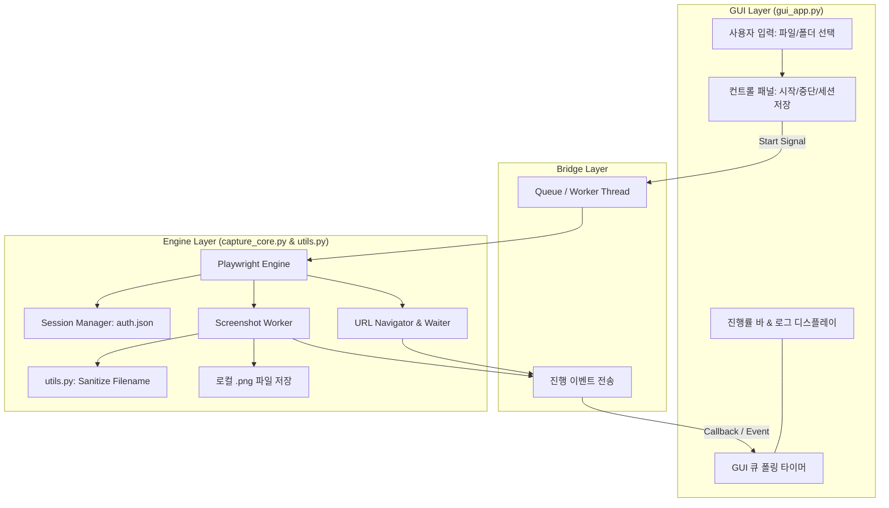

# 웹사이트 화면 캡처 GUI 프로그램 설계 사양서 (Spec)

## 1. 개요 및 목적
본 문서는 지정된 웹사이트 URL 목록을 읽어 각 페이지를 고화질 `.png` 이미지로 자동 캡처하고, 사용자가 지정한 로컬 폴더에 안전하게 저장하는 모던 데스크톱 애플리케이션의 세부 설계를 정의합니다.

### 주요 목표
- 텍스트 파일 기반의 대량 URL 순차 방문 및 고화질 스크린샷 자동 저장
- 로그인/인증이 필요한 인트라넷/그룹웨어 사이트(예: doto.kr)를 위한 1회 브라우저 수동 로그인 및 영구 세션 보존
- 실시간 진행 상황(프로그레스 바, 로그 창) 확인 및 작업 중단/재개 제어
- Windows 환경에서 직관적인 UI 및 간편한 실행성 확보

---

## 2. 기술 스택 및 라이브러리

- **프로그래밍 언어**: Python 3.10+
- **GUI 프레임워크**: `customtkinter` (현대적인 모던 다크/라이트 테마 지원)
- **브라우저 자동화 엔진**: `playwright` (Chromium 엔진 기반 고성능 헤드리스 캡처)
- **표준 라이브러리**: `threading`, `queue`, `pathlib`, `re`, `urllib.parse`, `json`

---

## 3. 시스템 아키텍처 및 모듈 구성

### 3.1 모듈 분리 원칙
- **단일 책임 원칙(SRP)**: GUI 표현(`gui_app.py`), 브라우저 제어(`capture_core.py`), 문자열 및 파일명 정제 유틸리티(`utils.py`)로 명확히 분리합니다.
- **멀티스레딩 안전성**: Playwright 실행은 전용 Worker Thread에서 구동되며, GUI 스레드와의 통신은 `queue.Queue` 및 콜백 이벤트로 격리되어 UI 블로킹이 발생하지 않습니다.

---

## 4. 컴포넌트별 상세 요구사항

### 4.1 UI 인터페이스 (`gui_app.py`)
- **URL 파일 선택**:
  - `Entry` 텍스트 필드 + `[파일 선택]` 버튼 (`filedialog.askopenfilename`)
  - 기본값: 현재 작업 폴더의 `web site.txt`가 존재할 경우 자동 채움
- **저장 폴더 선택**:
  - `Entry` 텍스트 필드 + `[폴더 선택]` 버튼 (`filedialog.askdirectory`)
  - 기본값: 사용자의 기본 다운로드 폴더 내 `doto_captures`
- **옵션 설정**:
  - `전체 페이지 스크롤 캡처(Full Page)` 체크박스 (기본 활성화)
  - `추가 대기 시간(초)` 슬라이더 또는 엔트리 (0.5초 ~ 5초, 기본 1.0초)
  - `화면 해상도(Viewport)` 설정: 기본 1920x1080
- **동작 제어 버튼**:
  - `[브라우저 로그인 및 세션 저장]`: Playwright 브라우저를 `headless=False`로 열어 사용자가 직접 사이트에 로그인하고 브라우저를 닫으면 현재 세션(쿠키, 로컬스토리지)을 `storage_state.json`으로 저장
  - `[캡처 시작]`: 백그라운드 스레드로 캡처 프로세스 시작
  - `[작업 중단]`: 진행 중인 캡처 플래그를 정지하고 안전하게 루프 종료
- **모니터링**:
  - `ProgressBar`: `0% ~ 100%` 실시간 반영
  - `TextBox` (로그창): 각 URL 접속 시작, 저장 완료 파일명, 실패 시 오류 원인 출력

### 4.2 캡처 코어 엔진 (`capture_core.py`)
- **`SessionManager`**:
  - `save_login_session(start_url, session_path)`: 헤드풀 브라우저를 띄워 사용자가 로그인할 수 있도록 대기 후 `storage_state.json` 생성
  - `has_valid_session(session_path)`: 기존 세션 파일 유효성 검사
- **`CaptureWorker`**:
  - `run_captures(urls, output_dir, options, progress_callback, log_callback, stop_event)`
  - 브라우저 인스턴스 초기화 (`headless=True`, `storage_state`가 있을 경우 자동 로드)
  - 반복 루프:
    1. `stop_event` 검사: 중단 요청 시 루프 탈출
    2. `page.goto(url, timeout=30000)` 호출
    3. `page.wait_for_load_state("networkidle")` 및 지정된 대기시간(`time.sleep`) 대기
    4. 파일명 생성 (`utils.sanitize_filename_from_url`)
    5. `page.screenshot(path=..., full_page=options.full_page)` 저장
    6. 콜백 호출로 UI에 실시간 진행 상황 및 로그 전달
    7. 오류 발생 시 예외 포착 후 실패 로그 기록 및 다음 URL로 지속

### 4.3 파일명 정제 유틸리티 (`utils.py`)
- URL에서 안전한 파일명을 도출하는 로직:
  - 도메인 이후의 경로(`path`) 추출 (예: `https://doto.kr/crm/contacts` -> `crm_contacts.png`)
  - 메인/루트 URL인 경우 `main.png` 또는 `home.png` 부여
  - 파일 시스템 예약 문자(`\ / : * ? " < > |`) 자동 언더스코어(`_`) 치환
  - 동일한 파일명이 발생할 경우 인덱스 접미사 (`_1`, `_2`) 자동 추가

---

## 5. 예외 및 에러 처리 (Edge Cases)
1. **URL 파일 형식 오류**:
   - 빈 줄, 주석 기호(`#`), 헤더성 텍스트(`web site` 등)는 자동으로 필터링
   - 유효하지 않은 URL 형태의 경우 스킵하고 경고 로그 출력
2. **네트워크 타임아웃 / 사이트 접속 불가**:
   - 타임아웃 30초 초과 시 에러 메시지 로깅 후 다음 URL로 정상 이동 (프로그램 비정상 종료 방지)
3. **저장 폴더 쓰기 권한 오류**:
   - 폴더가 없을 경우 자동 생성(`mkdir(parents=True, exist_ok=True)`)
   - 쓰기 실패 시 즉각 사용자에게 팝업 에러 안내
4. **작업 도중 사용자의 취소/창 닫기**:
   - `stop_event` 플래그를 통해 브라우저 컨텍스트를 깔끔하게 `close()`하고 스레드 안전하게 종료
